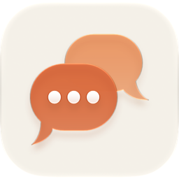
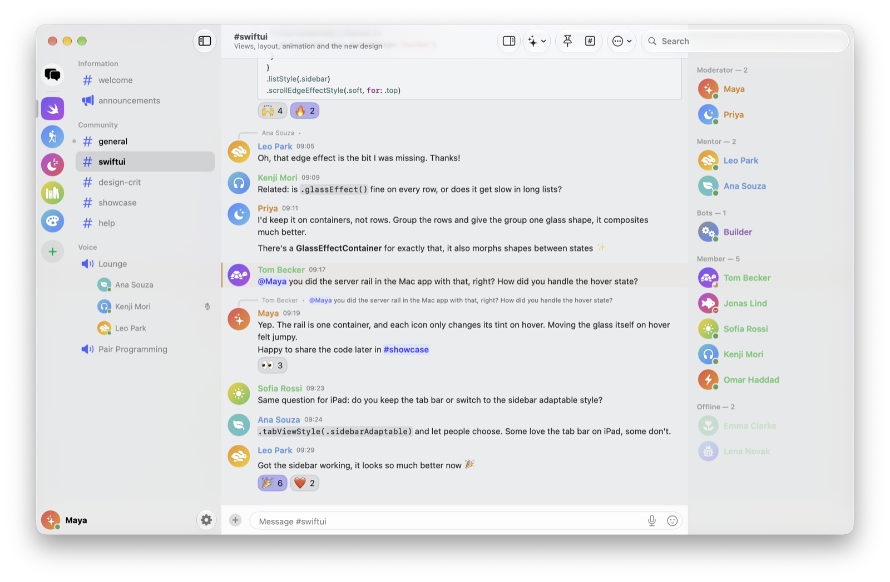
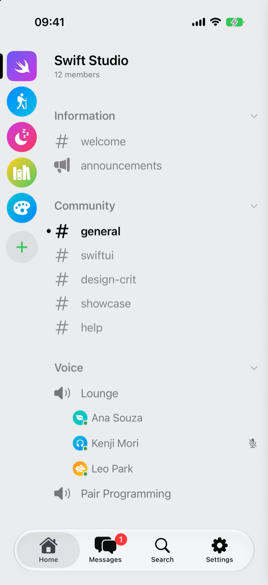
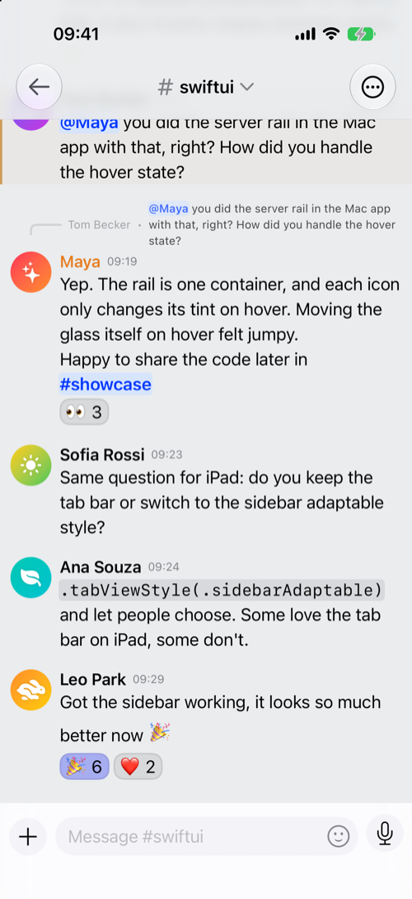
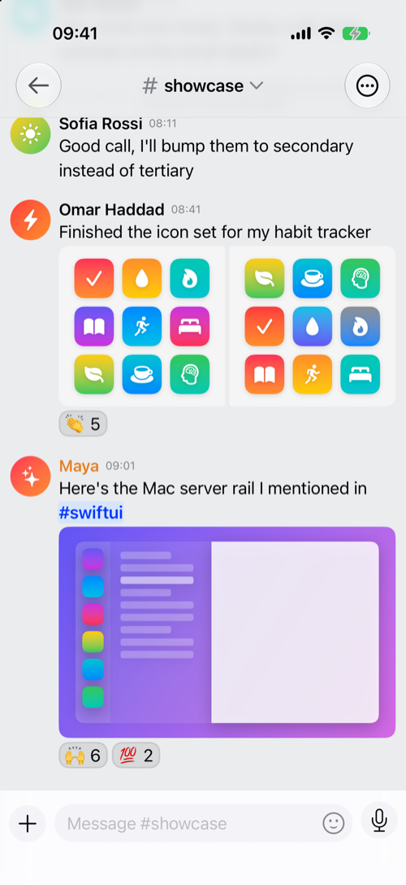
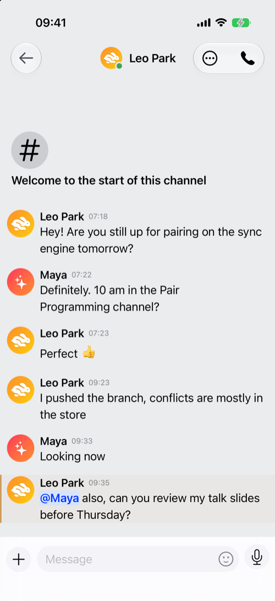

<div align="center">

<picture>
  <source media="(prefers-color-scheme: dark)" srcset=".github/assets/icon-dark.png">
  
</picture>

# Aicord

A native Discord client for iOS and macOS, written in pure Swift 6 and SwiftUI.


</div>

---

## Why a fork

Aicord is a fork of [Paicord](https://github.com/llsc12/Paicord) by [llsc12](https://github.com/llsc12). The upstream project doesn't accept AI-assisted pull requests, so the modernisation work lives here instead. Same app at heart, rebuilt on the newest Apple platforms with almost nothing but Apple's own frameworks.

## Highlights

<p align="center">

<picture>
  <source media="(prefers-color-scheme: dark)" srcset=".github/assets/screenshots/mac-chat-dark.png">
  
</picture>

</p>

<table align="center">
<tr>
<td align="center" valign="top">

<picture>
  <source media="(prefers-color-scheme: dark)" srcset=".github/assets/screenshots/iphone-server-dark.png">
  
</picture>

<sub>Channels and voice</sub>

</td>
<td align="center" valign="top">

<picture>
  <source media="(prefers-color-scheme: dark)" srcset=".github/assets/screenshots/iphone-chat-dark.png">
  
</picture>

<sub>Replies, mentions and reactions</sub>

</td>
<td align="center" valign="top">

<picture>
  <source media="(prefers-color-scheme: dark)" srcset=".github/assets/screenshots/iphone-showcase-dark.png">
  
</picture>

<sub>Images in the chat</sub>

</td>
<td align="center" valign="top">

<picture>
  <source media="(prefers-color-scheme: dark)" srcset=".github/assets/screenshots/iphone-dm-dark.png">
  
</picture>

<sub>Direct messages</sub>

</td>
</tr>
</table>

<p align="center"><sub>Screenshots use made-up demo data (see <a href=".github/CONTRIBUTING.md#demo-mode">demo mode</a>).</sub></p>

- **Voice and calls** — server voice channels and DM or group calls, end-to-end encrypted with DAVE, with push-to-talk and device choice
- **Nearly all of Discord's settings** — privacy, content filters, devices, connections, appearance, chat and notifications, saved to your account so the official apps see them too
- **One search for everything** — servers, channels, people and messages, with date and regex filters, opening a result right at the message
- **Intelligence, read-only and on device by default** — translate messages, summarize channels and catch up on servers, ask a channel or explain what a message refers to, with links back to the messages; an OpenAI-compatible API is optional
- **Notifications that follow your Discord rules** — per server and channel, quiet hours, keywords, Reply and Mark as Read, without a push server
- **Messages done properly** — formatting from the edit menu or ⌘B and friends, a Formatted Message editor with a live preview, slash commands and bot buttons, menus and forms, voice messages, polls you can vote in and create, pins, a thread browser, Discord's system lines, forwards, message requests and a spam folder, friend requests and Add Friend, a long-press menu with quick reactions
- **Tools for moderators** — create a server from scratch or a template, timeout, kick and ban with a reason, channels, categories and roles with every permission and per-channel overrides, AutoMod, emoji and stickers, bans and the audit log, shown only with the right permissions
- **Invites that open in the app** — create invite links, preview a server before joining, and a Safari extension that sends discord.gg links straight to Aicord
- **Things the official app doesn't do** — a gallery of a channel's media, links and files, channel export to Markdown or PDF, private notes and tags about people, offline reading, message reminders and saved messages, ghost ping (deleted or edited), keyword and person alerts, deleted messages and edit history kept in memory, hidden channels and who can view them, a local word filter, pinned servers and channels
- **Part of the system** — Spotlight for DMs, channels and saved messages, an unread and mentions widget, a Live Activity for voice calls, Shortcuts and Siri, and Handoff between iPhone and Mac
- **Native on iPhone and Mac** — system lists and Liquid Glass throughout, Swift 6 with strict concurrency, iOS 26 and macOS 26, and almost only Apple's own frameworks
- **Swapped for system APIs or removed** — SwiftUIX, Nuke, Sparkle, Lottie, SettingsKit, SwiftUIIntrospect, HCaptcha, KeychainAccess, CodeScanner, MijickCamera, MeshGradient, ColorCube, SwiftEmoji, FLEX, Loupe, Conditionals, SwiftPrettyPrint, UInt128, Yams, swift-crypto, multipart-kit and the whole SwiftNIO stack. What's left: swift-log, swift-protobuf, zstd, swift-syntax (build-time macros only), and for voice DaveKit (end-to-end encryption, which brings OpenSSL) and swift-opus.

Everything else that's new or fixed is in **[the changelog](CHANGELOG.md)**, and what's next in the [roadmap](ROADMAP.md).

## Building

Requires **Xcode 26** on macOS 26.

```bash
git clone https://github.com/lakafior/Aicord.git
open Aicord/Aicord.xcworkspace
```

Pick the **Aicord** scheme, choose a Mac or an iOS 26 device or simulator, and run. The macOS app is built for Apple silicon only. There are no prebuilt releases of Aicord yet.

## Contributing

AI-assisted contributions are welcome. See [CONTRIBUTING.md](.github/CONTRIBUTING.md) for how to help out, and [ARCHITECTURE.md](ARCHITECTURE.md) for a map of the code.

## About notifications

Discord's real push notifications go through Apple's push service with Discord's own certificate, so Apple delivers them only to the official Discord app. Aicord can't receive them, and it won't run a server that keeps your account token to forward them. So Aicord notifies you only while it's running: on a Mac that's whenever the app is open, but iOS suspends apps in the background within minutes, after which nothing arrives until you open Aicord again. Keep the official app installed (with its notifications on) if you need to be reached on iPhone.

## A word of caution

Like every third-party client, using Aicord breaks Discord's Terms of Service. It identifies itself as close to the official client as it can, but the risk of an account ban never goes away. Use it at your own risk.

## Credits

- [Paicord](https://github.com/llsc12/Paicord) by llsc12, the project this fork is built on
- [DiscordBM](https://github.com/DiscordBM/DiscordBM) and [Textual](https://github.com/gonzalezreal/textual), modified versions of which live in `AicordKit` and `Textual`
- [Discord Userdoccers](https://docs.discord.food) for the unofficial API documentation

Licensed under [GPL-3.0](LICENSE).
